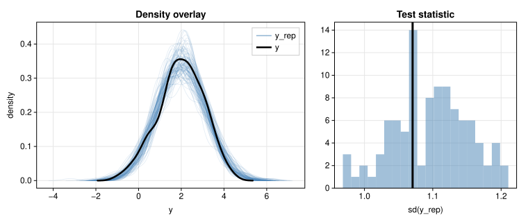
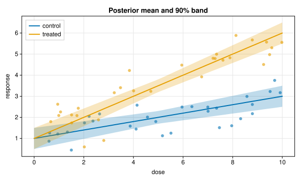
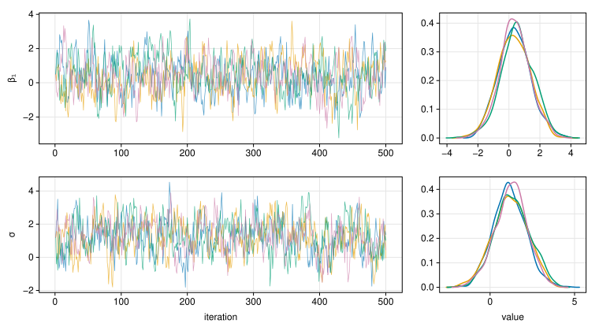
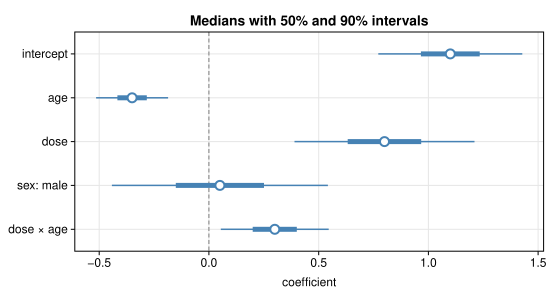

# PracticalBayesPlot.jl

[](https://evoart.github.io/PracticalBayesPlot.jl/stable/)
[](https://evoart.github.io/PracticalBayesPlot.jl/dev/)
[](https://github.com/EvoArt/PracticalBayesPlot.jl/actions/workflows/CI.yml?query=branch%3Amain)
[](https://codecov.io/gh/EvoArt/PracticalBayesPlot.jl)

A very lightweight, pure Julia plotting package that targets the small set of
plots typically used in the [Bayesian workflow](https://arxiv.org/abs/2011.01808):
posterior predictive checks, effect plots, trace plots, residuals and
interval plots. It has no dependencies and draws figures as SVG.

It loads in about 40 ms. A first figure, such as a posterior predictive
check with 50 overlaid densities and a histogram, compiles almost nothing
because the package's code is cached at precompile time.

The design is taken from [Makie](https://github.com/MakieOrg/Makie.jl): the
function names (`Figure`, `Axis`, `lines!`, `hist!`, ...), the `fig[i, j]`
layout, the keyword names and the default colour cycle all follow Makie, so
Makie plotting code ports with few changes. Credit for that design goes to
the Makie developers; this package reimplements a small part of it. Future
work is planned to integrate the two, so that a `Figure` or `Axis` made with
this package can be placed in a larger, more feature-rich Makie figure.

## Usage

The package exports nothing, because almost all of its names are also
exported by Makie. Load it under a short name and qualify calls:

```julia
import PracticalBayesPlot as PBP
```

This works the same whether or not Makie is loaded in the session.

## Examples

The examples run in order in one session; the data are simulated stand-ins
for model output.

### Posterior predictive check

<!-- figure: ppcheck -->
```julia
import PracticalBayesPlot as PBP
using Random
rng = Xoshiro(1)
y = 2 .+ randn(rng, 200)                  # observed data
yrep = 2 .+ 1.1 .* randn(rng, 100, 200)   # 100 replicated data sets, one per row

fig = PBP.Figure(; size = (760, 320))
ax = PBP.Axis(fig[1, 1]; xlabel = "y", ylabel = "density", title = "Density overlay")
for s in 1:100
    PBP.density!(ax, view(yrep, s, :); color = (:steelblue, 0.15), linewidth = 0.8,
                 label = s == 1 ? "y_rep" : "")
end
PBP.density!(ax, y; color = :black, linewidth = 2.5, label = "y")
PBP.axislegend(ax)

sd(v) = sqrt(sum(abs2, v .- sum(v) / length(v)) / (length(v) - 1))
ax2 = PBP.Axis(fig[1, 2]; xlabel = "sd(y_rep)", title = "Test statistic")
PBP.hist!(ax2, [sd(view(yrep, s, :)) for s in 1:100]; bins = 20, color = (:steelblue, 0.5))
PBP.vlines!(ax2, sd(y); color = :black, linewidth = 3)
PBP.colsize!(fig, 1, PBP.Relative(0.6))
PBP.save("ppcheck.svg", fig)
```



### Fitted lines with credible bands

<!-- figure: effects -->
```julia
x = range(0, 10; length = 50)
fig = PBP.Figure(; size = (600, 360))
ax = PBP.Axis(fig[1, 1]; xlabel = "dose", ylabel = "response",
              title = "Posterior mean and 90% band")
for (i, (group, slope)) in enumerate((("control", 0.2), ("treated", 0.5)))
    xs = 10 .* rand(rng, 30)
    PBP.scatter!(ax, xs, 1 .+ slope .* xs .+ 0.6 .* randn(rng, 30);
                 color = (i, 0.6), markersize = 6)
    mu = 1 .+ slope .* x
    half = 0.3 .+ 0.04 .* abs.(x .- 5)
    PBP.band!(ax, x, mu .- half, mu .+ half; color = (i, 0.25))
    PBP.lines!(ax, x, mu; color = i, linewidth = 2, label = group)
end
PBP.axislegend(ax; position = :lt)
```



### Trace plots

<!-- figure: trace -->
```julia
function ar1(rng, n, mu, phi)   # stands in for one MCMC chain
    x = fill(mu, n)
    for t in 2:n
        x[t] = mu + phi * (x[t-1] - mu) + sqrt(1 - phi^2) * randn(rng)
    end
    return x
end

fig = PBP.Figure(; size = (760, 420))
for (row, (name, mu)) in enumerate((("β₁", 0.5), ("σ", 1.2)))
    trace = PBP.Axis(fig[row, 1]; ylabel = name, xlabel = row == 2 ? "iteration" : "")
    dens = PBP.Axis(fig[row, 2]; xlabel = row == 2 ? "value" : "")
    for chain in 1:4
        draws = ar1(rng, 500, mu, 0.7)
        PBP.lines!(trace, draws; color = (chain, 0.7), linewidth = 0.7)
        PBP.density!(dens, draws; color = chain)
    end
end
PBP.colsize!(fig, 1, PBP.Relative(0.7))
```



### Coefficient intervals

<!-- figure: intervals -->
```julia
terms = ["dose × age", "sex: male", "dose", "age", "intercept"]
est = [0.3, 0.05, 0.8, -0.35, 1.1]
se = [0.15, 0.3, 0.25, 0.1, 0.2]

fig = PBP.Figure(; size = (560, 300))
ax = PBP.Axis(fig[1, 1]; xlabel = "coefficient", title = "Medians with 50% and 90% intervals")
PBP.vlines!(ax, 0; color = :gray, linestyle = :dash)
PBP.rangebars!(ax, terms, est .- 1.64se, est .+ 1.64se; direction = :x, color = :steelblue)
PBP.rangebars!(ax, terms, est .- 0.67se, est .+ 0.67se; direction = :x, color = :steelblue, linewidth = 5)
PBP.scatter!(ax, est, terms; color = :white, strokecolor = :steelblue, strokewidth = 2, markersize = 9)
```



Strings as positions become categories, so `terms` labels the y axis.

### One-call forms

One-call forms make a figure with a single axis:

```julia
fig = PBP.hist(randn(1000); bins = 40, axis = (; xlabel = "x"))
PBP.lines!(PBP.current_axis(), [-2, 2], [0, 100])
```

## Showing figures

- VS Code, Jupyter and Pluto show a `Figure` inline (as SVG).
- In a terminal REPL, displaying a `Figure` opens it in the browser.
  `PBP.preview(fig)` does the same from anywhere.
- `PBP.save("fig.svg", fig)` writes SVG; `PBP.save("fig.html", fig)` writes a
  page holding the SVG. For PNG or PDF, convert the SVG (for example with
  `rsvg-convert` or Inkscape).
- `PBP.svg(fig)` returns the SVG as a string.

## What it draws

Names below are written without the `PBP.` prefix.

| Function | Draws |
|:---------|:------|
| `lines!(ax, x, y)` | lines; `NaN` breaks a line |
| `stairs!(ax, x, y; step)` | step lines (`:pre`, `:post`, `:center`) |
| `scatter!(ax, x, y)` | markers: `:circle`, `:rect`, `:diamond`, `:utriangle`, `:dtriangle` |
| `band!(ax, x, lower, upper)` | filled band, e.g. a credible band |
| `barplot!(ax, x, heights)` | bars; `x` may be strings |
| `hist!(ax, data; bins, normalization)` | histogram (`:none`, `:pdf`, `:probability`, `:density`) |
| `density!(ax, data)` | Gaussian kernel density estimate |
| `ecdfplot!(ax, data)` | empirical CDF |
| `rangebars!(ax, pos, low, high; direction)` | intervals, vertical or horizontal |
| `hlines!(ax, ys)`, `vlines!(ax, xs)` | reference lines across the axis |
| `text!(ax, x, y; text)` | text at data coordinates |
| `axislegend(ax, title; position)` | legend of the plots given a `label` |

Each has a one-call form without `!` (except the reference lines, text and
legend), and a form without `ax` that draws into `current_axis()`.

Common keywords: `color`, `alpha`, `linewidth`, `linestyle` (`:solid`,
`:dash`, `:dot`, `:dashdot`), `label`. A colour is a name (`:steelblue`,
`"red"`), a hex string, an `(r, g, b)` tuple with values in 0–1, an integer
index into `wong_colors()`, or `(colour, alpha)`. Without `color`, plots
take the next colour of the axis's cycle (Wong's colour-blind-safe palette,
in Makie's order).

Axis attributes (keywords to `Axis`, or set later as `ax.xlabel = "..."`):
`title`, `xlabel`, `ylabel`, `xticks`, `yticks` (positions, or
`(positions, labels)`), `limits`, `xgridvisible`, `ygridvisible`. Also
`xlims!`, `ylims!`, `limits!`. Layout: `Axis(fig[i, j])`, with ranges to
span cells (`fig[1:2, 1]`); `colsize!` and `rowsize!` set relative sizes.

`PBP.kde(x, grid)` is the density estimate `density!` uses,
for code that needs the numbers.

## Gallery

[examples/pbr_plots.jl](https://github.com/EvoArt/PracticalBayesPlot.jl/blob/main/examples/pbr_plots.jl) draws PracticalBayesianRegression's
plots (`pp_check` of every type, `plot_effects` with and without groups and
for categorical predictors, `trace_plot`, `residual_plot`) and a
bayesplot-style interval plot from plain arrays. Write them to
`examples/out/` with

```
julia --project=examples examples/pbr_plots.jl
```

## Not supported

Log axes, colour maps and heatmaps, 3-d plots, and raster output. They are
outside the plots the package is for.
